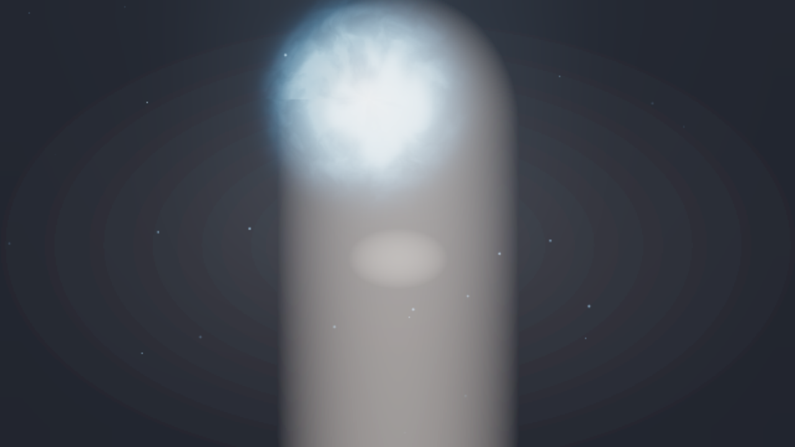
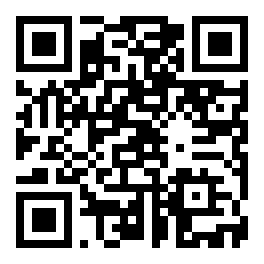
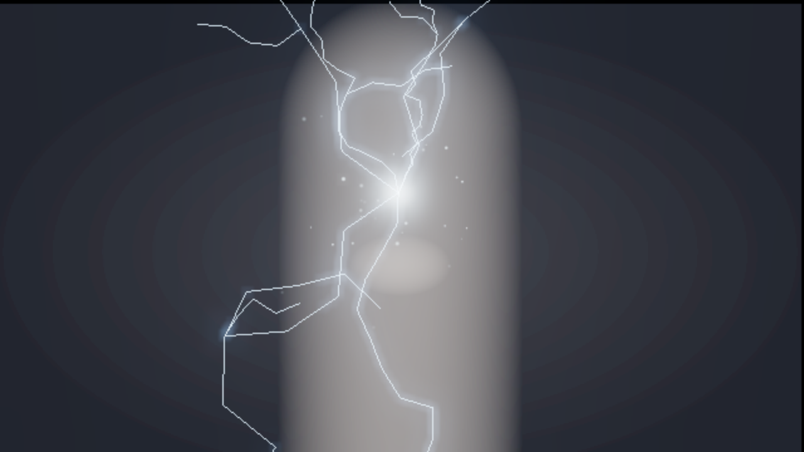
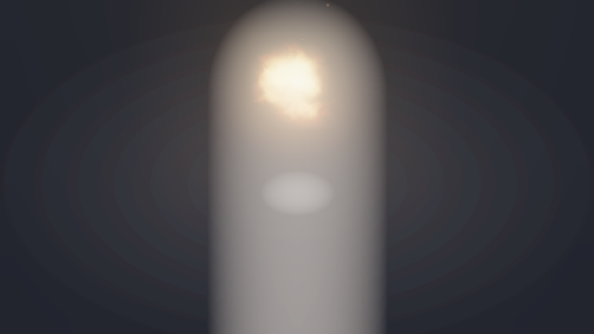
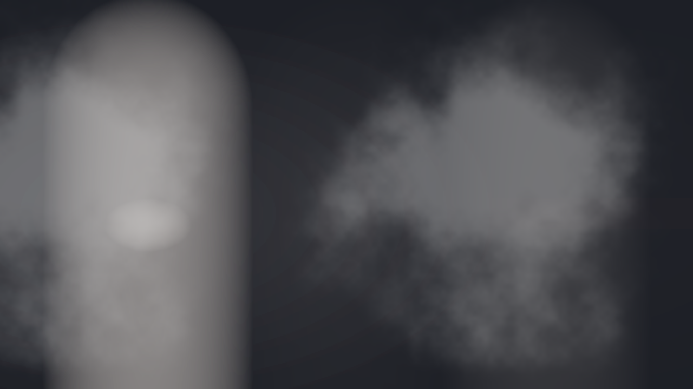
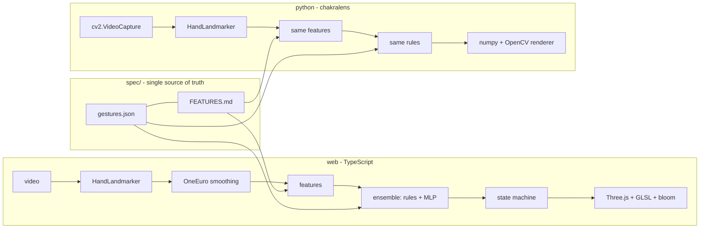

# Chakra Lens

Point your camera at your hands, make a Naruto hand sign, and watch the jutsu fire. Runs on your phone, in your browser, with nothing leaving your device.



[](https://github.com/Bakr1m/anime-chakra/actions/workflows/ci.yml)


## Try it on your phone

Open this on your phone (HTTPS, no install needed, works offline after the first load):

**https://bakr1m.github.io/anime-chakra/**



Hold a sign steady for about a second. Start with Rasengan: palm to the camera, fingers loosely cupped like you are holding an orange.

A note on honesty: I don't own a test phone farm. Everything mobile is verified in Chromium's iPhone 14 / Pixel 7 emulation (15 e2e checks green). Real-device frame times are unmeasured; `?debug=1` has a "Copy device report" button, and `docs/DEVICE_TESTING.md` explains how to paste results back.

## Why I built it

I wanted a project that touches the whole stack I care about: on-device ML inference, classical CV features, real-time graphics, and the unglamorous parts (Docker, CI, PWA installability). Anime hand signs are a good fit because the poses are geometrically crisp: finger extension ratios and palm orientation separate them well, which makes a rule-based baseline genuinely competitive and gives a small neural net something clean to learn.

## Run locally

Web (desktop, no camera needed for the demos):

```sh
docker run -p 8080:8080 bakr1m/anime-chakra
# then open http://localhost:8080/?demo=rasengan
```

Desktop CLI with your webcam:

```sh
pip install -e "./python[gui]"
chakralens run --camera 0
# keys: q quit, s screenshot, 1-4 force a jutsu, 0 back to auto
```

Phone over the terminal (tunnel URL + QR in one step):

```sh
make phone        # public https://*.trycloudflare.com URL, printed + QR
make phone-lan    # https://<lan-ip>:8443 via Caddy (one-time cert warning)
```

## Jutsu

| Jutsu | Character | Sign | Shot |
|---|---|---|---|
| Rasengan | Naruto | Palm to camera, fingers cupped (openness 0.4-0.75) |  |
| Chidori | Sasuke / Kakashi | Knife hand, four fingers together, sideways |  |
| Katon: Gokakyu | Sasuke / Itachi | Tiger seal, two hands touching, hold 0.5 s |  |
| Kage Bunshin | Naruto | Cross seal, finger lines in an X |  |
| Sharingan (stretch) | Sasuke | Point your index at your eye | web only |
| Kurama Cloak (stretch) | Naruto | Both fists raised high | web only |

## How it works



Per frame, the web app tracks up to two hands, smooths the 21 landmarks with a One Euro filter, and extracts scale-free features: per-finger extension ratios and curl angles, spread, a unit palm normal, the pointing vector, openness, plus two-hand geometry (wrist distance, finger-line intersection and angle). A rule set over those features votes alongside a tiny 63-64-7 MLP trained on synthetic hands. Agreement wins; disagreement needs 0.9 confidence. A state machine adds hysteresis (6 frames to fire, 8 to release), a 0.6 s ease-out charge ramp, and per-jutsu cooldowns.

Python generates seeded landmark fixtures from the same formulas, and both suites must agree on labels and features within 1e-4 (`make parity`, enforced in CI). If the math drifts between languages, the build fails.

## Rendering notes

Rasengan is a billboard shader: domain-warped fBm in polar coordinates makes the spiral streaks rotate fast while a second shell counter-rotates, with a tight white core, a fresnel rim, 250-400 orbiting point sprites, spring wobble toward the hand, and a soft blue light quad. Chidori rebuilds seeded midpoint-displacement bolts every 2nd frame (~30 Hz flicker) with side branches, a hot palm core, gravity sparks, flash and shake scaled by charge.

What is approximated: clones are masked video copies, not re-rendered people; the Katon mouth anchor falls back to above-the-hands without a face; the demo backdrop is procedural. The OpenCV renderer is deliberately simpler (documented in `python/src/chakralens/render/`): numpy additive layers, `GaussianBlur` bloom, rotated noise tiles instead of shaders. It looks decent at 320p and runs ~11-13 fps on a CPU desktop.

## Train it on your own hands

The shipped classifier never saw a real hand. It is a synthetic baseline (99.6% held-out on its own generator, which mostly proves the generator is self-consistent; see `docs/ML.md` and `docs/img/confusion.txt`). To fix that:

```sh
# film ~20 s per sign on your phone into videos/<label>/...
chakralens extract videos/ --out data/
chakralens train          # picks up data/ automatically
chakralens evaluate       # now prints a second, real-data accuracy line
```

Or press `R` in the web app to record 3 s for the selected label and drop the download into `data/`.

## Performance

Measured numbers with environments in `docs/PERF.md`. Short version: the gesture brain costs ~0.07 ms per decision (node) and ~0.1 ms per hand (Python); pixels dominate. Python renders ~11-13 fps at 640x480 on CPU (Gaussian bloom is the hog; the 20 fps target is unmet and documented). The web demo holds ~15.7 fps under SwiftShader software rendering in CI, which says nothing about real GPUs. Phone numbers come from emulation until someone pastes a device report.

## Privacy

All inference runs on your device, in the browser or in the local CLI. Frames are never uploaded anywhere. The camera starts only after you tap Start.

## Development

```sh
make check    # web lint+typecheck+unit, python ruff+mypy+pytest
make parity   # cross-language fixture gate
make e2e      # Playwright: desktop + iPhone 14 + Pixel 7
```

`CONTRIBUTING.md` covers setup and how to add a new jutsu (one `spec/gestures.json` entry, one folder, one fixture, one demo case). CI runs checks, parity, e2e, multi-arch Docker pushes (Docker Hub + GHCR), and the Pages deploy.

## Limitations and next steps

- No real-hand training data yet; the MLP is a synthetic baseline.
- No physical-phone measurements yet; the harness (`?debug=1` report button) is ready.
- Python desktop renderer misses 20 fps on CPU; bloom needs an ROI pass.
- Face/segmentation models download on first use in the browser; the Docker image and `models/` carry them for offline use.
- Next: real dataset + retrain, pose-based shoulders for Kurama, sound design pass.

## Credits

Built with MediaPipe Tasks (Hand/Face landmarkers, selfie segmentation), Three.js, OpenCV, and scikit-learn. Models are Apache-2.0, (c) Google; see `THIRD_PARTY.md`.

Fan project, non-commercial. Naruto is (c) Masashi Kishimoto / Shueisha / TV Tokyo. No official assets are used: every visual and sound here is procedural, original code. No affiliation.

## License

MIT. See `LICENSE`.
